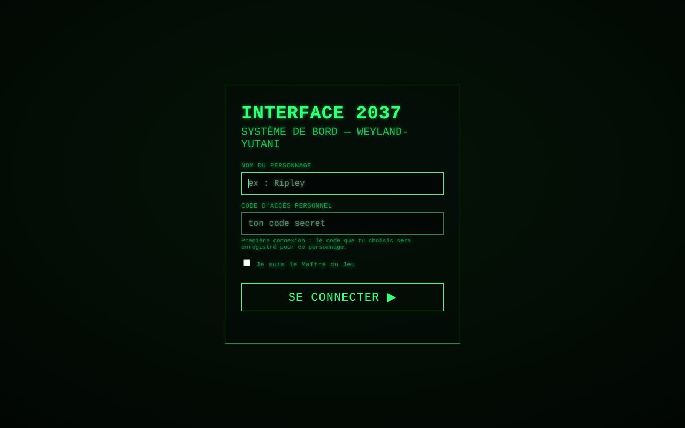
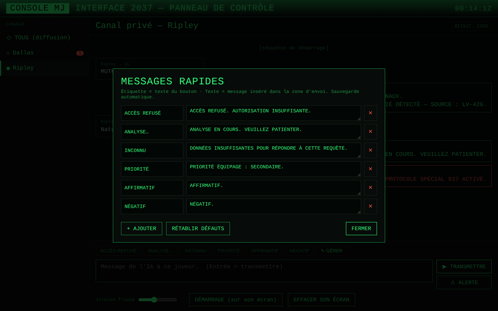

# Terminal de bord — Interface 2037

Un faux terminal d'ordinateur de bord façon *Alien* (MU-TH-UR 6000) pour tes parties du jeu de rôle **Alien**. Le Maître du Jeu joue l'IA du vaisseau depuis une console de contrôle ; chaque joueur voit un écran CRT vert phosphore sur lequel les réponses de l'IA s'affichent lettre par lettre, avec sons et effets d'écran cathodique.

Aucune dépendance : un seul fichier Python (bibliothèque standard) + un fichier HTML.



## Démarrage rapide

1. Mets `serveur.py` et `index.html` dans le même dossier.
2. Lance le serveur :

   ```
   python serveur.py
   ```

3. **MJ** : ouvre `http://localhost:8000`, coche « Je suis le Maître du Jeu » et entre le code admin (par défaut `nostromo` — change-le en haut de `serveur.py`).
4. **Joueurs** (même réseau Wi-Fi) : ouvrent `http://IP-DE-TON-PC:8000` (l'IP est affichée au lancement du serveur).

## Côté joueur


Le joueur entre le nom de son personnage et un **code d'accès personnel** : le code choisi à la première connexion est enregistré pour ce personnage, et sera exigé à chaque connexion suivante. Personne ne peut donc lire les conversations d'un autre en tapant simplement son nom.

Sur son terminal, le joueur ne voit que ce qui lui est adressé (canal privé ou diffusion générale). Il peut poser des questions à l'IA — elles n'arrivent qu'au MJ. Boutons en haut à droite : **SON** (bips de frappe, alertes), **AMBRE** (thème orange), **CRT** (désactiver les effets d'écran).

## Côté MJ


La console MJ affiche un canal par joueur (pastille verte = en ligne, badge rouge = messages non lus) plus un canal **TOUS** pour la diffusion générale. Pour chaque message tu contrôles la **vitesse de frappe** sur l'écran du joueur, et tu disposes de boutons **⚠ ALERTE** (texte rouge + son d'alarme), **DÉMARRAGE** (séquence de boot sur son écran) et **EFFACER SON ÉCRAN**.

Le bouton **RÉINIT. CODE** en haut d'un canal privé efface le code d'accès du personnage si un joueur l'a oublié : ses sessions sont déconnectées et il choisira un nouveau code à sa prochaine connexion.

### Messages rapides personnalisables



Les puces au-dessus de la zone d'envoi insèrent des répliques prédéfinies (« ACCÈS REFUSÉ », « ANALYSE… », etc.). Le bouton **✎ GÉRER** ouvre un panneau pour les ajouter, modifier ou supprimer. Tout est sauvegardé automatiquement dans le navigateur et retrouvé d'une session à l'autre.

## Jouer à distance

Le plus simple : un tunnel Cloudflare (gratuit, sans compte), sans rien changer au code ni ouvrir de port sur ta box.

1. Télécharge `cloudflared` : https://developers.cloudflare.com/cloudflare-one/networks/connectors/cloudflare-tunnel/downloads/
2. Lance ton serveur normalement (`python serveur.py`).
3. Dans un second terminal :

   ```
   cloudflared tunnel --url http://localhost:8000
   ```

4. Envoie l'URL `https://xxxx.trycloudflare.com` affichée à tes joueurs.

L'URL change à chaque relance du tunnel ; ton PC doit rester allumé pendant la partie. Évite la redirection de port sur ta box : le tunnel n'expose que le site, pas ta machine.

## Fichiers et configuration

`serveur.py` : le serveur (HTTP + API JSON). En haut du fichier : `PORT`, `ADMIN_CODE` (code MJ — à changer !) et `PERSIST`. `index.html` : toute l'interface (joueur + MJ). `partie.json` : créé automatiquement — historique des messages et codes d'accès des personnages ; il survit aux redémarrages du serveur. Pour repartir de zéro, supprime-le. Les codes y sont stockés en clair : n'utilisez pas de vrais mots de passe.
